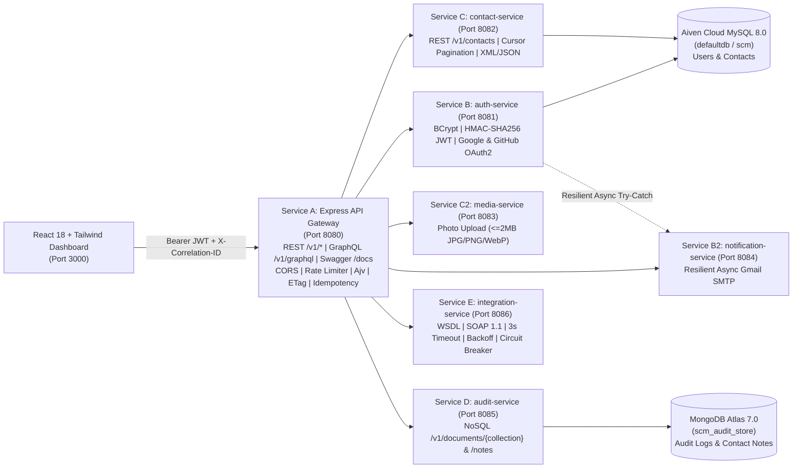

# Smart Contact Manager (SCM) — Enterprise Microservices Architecture

An enterprise-grade microservices transformation of the **Smart Contact Manager (SCM)** built with **Node.js (ES Modules) / Express.js Edge API Gateway**, **Java 21 (LTS) / Spring Boot 3.3.4 Domain Microservices**, **React 18 + Vite + Tailwind CSS Frontend**, **Aiven Cloud MySQL 8.0 / PostgreSQL-compatible Relational SQL**, and **MongoDB Atlas 7.0 NoSQL Document Store**.

---

## 1. Project Overview & Preserved Features
- **Mandatory Sign-Up-First Authentication Workflow**: Unauthenticated visitors are routed to `/signup` first, register via Email/Password, Google OAuth 2.0, or GitHub OAuth 2.0, and are redirected to `/login` for credential verification before entering the dashboard (`/`). Unregistered login attempts are rejected with an RFC 7807 `404 Resource Not Found` error.
- **Full Contact Lifecycle (CRUD, Search, Segments & Country Code Selector)**: Supports `GET`, `POST`, `PUT`, `PATCH`, `DELETE`, `HEAD`, and `OPTIONS` on `/v1/contacts`, international country code selector (`+91`, `+1`, `+44`, `+61`, `+49`, `+65`, `+971`), E.164 normalization, Ajv Draft-07 JSON Schema validation, and segment filtering (`VIP`, `Colleague`, `Lead`, `Family`, `Favorites`).
- **Polyglot Cloud Persistence**:
  - **Relational SQL (`Aiven Cloud MySQL 8.0` `defaultdb` + Local MySQL `scm`)**: Stores `users`, `contact`, and `idempotency_keys`.
  - **NoSQL Document Store (`MongoDB Atlas 7.0` `scm_audit_store`)**: Stores `audit-logs`, `contact-notes`, `activity-stream`, and `idempotency-keys`.
- **Resilience & Multi-Protocol API Layer**: REST (`/v1/*`), GraphQL (`/v1/graphql` & `/graphql`), WSDL/SOAP 1.1 (`/v1/soap/wsdl` & `/v1/soap/execute`), OpenAPI 3.0.3 (`/v1/openapi.yaml`), and Swagger UI (`/docs`).

---

## 2. Architecture Overview & Mermaid Diagram



---

## 3. Responsibilities of Each Service

| Service | Port | Directory | Responsibilities |
| :--- | :--- | :--- | :--- |
| **`api-gateway`** | `8080` | `api-gateway/` | Express.js public entry point, `/v1` versioning, CORS, token-bucket rate limiting (`429`), Ajv Draft-07 validation (`422`), `Idempotency-Key` replay & `409 Conflict` detection, `ETag`/`304`, JSON/XML negotiation (`406`/`415`), `/v1/graphql`, `/docs` Swagger UI, and RFC 7807 error normalization. |
| **`auth-service`** | `8081` | `auth-service/` | User registration (`/v1/auth/users`), login (`/v1/auth/tokens`), BCrypt password hashing, HMAC-SHA256 JWT issuance/verification, RBAC (`ROLE_USER`, `ROLE_ADMIN`), and Google/GitHub OAuth 2.0 callbacks. |
| **`contact-service`** | `8082` | `contact-service/` | Contact CRUD (`/v1/contacts`), contact groups (`/v1/contact-groups`), opaque base64url keyset cursor pagination with RFC 5988 `Link: rel="next"`, and parameterized SQL persistence. |
| **`media-service`** | `8083` | `media-service/` | Contact avatar validation (`<= 2MB`, `image/jpeg`, `image/png`, `image/webp`) and storage (`/v1/media/photos`). |
| **`notification-service`** | `8084` | `notification-service/` | Asynchronous Gmail SMTP (`smtp.gmail.com:587`) welcome and password recovery email dispatch with non-blocking fallback. |
| **`audit-service`** | `8085` | `audit-service/` | MongoDB Atlas 7.0 document store (`/v1/documents/{collection}` and `/v1/contacts/{id}/notes`) for audit trails and contact notes. |
| **`integration-service`** | `8086` | `integration-service/` | WSDL provider (`GET /v1/soap/wsdl`) and SOAP 1.1 client (`POST /v1/soap/execute` & `/v1/integrations/soap-checks`) with 3s deadline (`504`), exponential backoff retry (`delay * 2^attempt`), and 3-state circuit breaker (`CLOSED`, `OPEN`, `HALF_OPEN`). |

---

## 4. Repository Structure

```text
SERVICE_BASED/
├── api-gateway/                          # Express.js Public API Gateway (Port 8080)
├── auth-service/                         # Spring Boot Auth & User Service (Port 8081)
├── contact-service/                      # Spring Boot Contact Service (Port 8082)
├── media-service/                        # Spring Boot Media Upload Service (Port 8083)
├── notification-service/                 # Spring Boot Async Notification Service (Port 8084)
├── audit-service/                        # Spring Boot MongoDB Audit & Document Service (Port 8085)
├── integration-service/                  # Spring Boot WSDL/SOAP & Circuit Breaker Service (Port 8086)
├── common-lib/                           # Shared RFC 7807 Problem Details, JWT, CircuitBreaker, Filters
├── frontend-react/                       # React 18 + Vite + Tailwind CSS SPA (Port 3000)
├── database/
│   ├── mysql/001_initial_schema.sql      # MySQL 8.0 / Aiven Cloud SQL migration
│   ├── postgres/001_initial_schema.sql   # PostgreSQL 16 compatible SQL migration
│   └── mongodb/001_collections_and_indexes.js # MongoDB Atlas collections & indexes
├── docs/
│   ├── current-architecture.md
│   ├── microservices-architecture.md
│   ├── migration-plan.md
│   ├── requirements-traceability.md
│   ├── openapi.yaml
│   ├── database-schema.md
│   ├── deployment.md
│   └── testing.md
├── scripts/
│   ├── migrate.sh                        # Database initialization & migration script
│   └── smoke-test.sh                     # End-to-end live HTTP smoke test script
├── tests/api.test.js                     # Jest 29 + Supertest 6 28-Requirement Verification Suite
├── contact-schema.json                   # Ajv Draft-07 Contact JSON Schema
├── validate-schema.js                    # Standalone + Gateway Ajv Schema Validator
├── openapi.yaml                          # Hand-written OpenAPI 3.0.3 Specification
├── docker-compose.yml                    # Full multi-container orchestration
├── Dockerfile                            # Multi-stage Java 21 / Node container build
├── render.yaml                           # Render Cloud Blueprint
└── .env.example                          # Twelve-Factor environment template
```

---

## 5. Prerequisites & Local Setup Instructions

### Prerequisites
- **Node.js** `>= 20.x` & **npm**
- **Java 21 (LTS)** & **Maven 3.9+** (for Spring Boot services)
- **Docker & Docker Compose** (optional, for containerized startup)

### Install, Migrate, Test & Start
```bash
# 1. Install dependencies
npm install

# 2. Run database migrations (Aiven MySQL + Local MySQL + MongoDB Atlas)
./scripts/migrate.sh

# 3. Run Ajv JSON Schema validation + Jest & Supertest 28-Requirement Suite
npm test

# 4. Start the API Gateway & Frontend Server (Ports 8080, 8081, 3000)
npm start

# 5. Run live end-to-end HTTP smoke tests
./scripts/smoke-test.sh
```

### Docker Compose Commands
```bash
cp .env.example .env
docker compose up --build -d
docker compose ps
docker compose logs -f api-gateway
```

---

## 6. Concrete API Examples (REST, GraphQL, XML, Pagination, Idempotency, ETag, SOAP)

### A. Authentication & JWT Acquisition (`/v1/auth/users` & `/v1/auth/tokens`)
```bash
# Register a new user (201 Created)
curl -X POST http://localhost:8080/v1/auth/users \
  -H "Content-Type: application/json" \
  -d '{"name":"Ada Lovelace","email":"ada@scm.enterprise.io","password":"Password123!","phoneNumber":"+919876543210"}'

# Authenticate and obtain a Bearer JWT (201 Created)
curl -X POST http://localhost:8080/v1/auth/tokens \
  -H "Content-Type: application/json" \
  -d '{"email":"admin@scm.enterprise.io","password":"AdminPass123!"}'
```

### B. Idempotent Contact Creation (`POST /v1/contacts` with `Idempotency-Key`)
```bash
# First request -> 201 Created (X-Idempotent-Replayed: false)
curl -i -X POST http://localhost:8080/v1/contacts \
  -H "Content-Type: application/json" \
  -H "Idempotency-Key: idem-demo-001" \
  -d '{"name":"Rohan Deshmukh","email":"rohan@scm.enterprise.io","phoneNumber":"+919822334455"}'

# Second replay with identical payload -> 201 Created (X-Idempotent-Replayed: true, no duplicate created)
# Reuse of same Idempotency-Key with different payload -> 409 Conflict
```

### C. Cursor Pagination (`GET /v1/contacts?limit=2&cursor=...`)
```bash
curl -i "http://localhost:8080/v1/contacts?limit=2"
# Returns Link: </v1/contacts?cursor=Y250LTEwMDI&limit=2>; rel="next" and nextCursor in JSON body
```

### D. Content Negotiation (`JSON` & `XML`)
```bash
# Request XML representation (200 OK, Content-Type: application/xml)
curl -i -H "Accept: application/xml" http://localhost:8080/v1/contacts/cnt-1001

# Request unsupported representation -> 406 Not Acceptable
curl -i -H "Accept: application/pdf" http://localhost:8080/v1/contacts/cnt-1001
```

### E. ETag & Conditional GET (`304 Not Modified`)
```bash
# 1. Fetch contact and inspect ETag header (e.g. ETag: "a1b2c3d4e5f60718")
curl -i http://localhost:8080/v1/contacts/cnt-1001

# 2. Re-request with If-None-Match -> 304 Not Modified (empty body)
curl -i -H 'If-None-Match: "a1b2c3d4e5f60718"' http://localhost:8080/v1/contacts/cnt-1001
```

### F. GraphQL Query & Mutation (`POST /v1/graphql`)
```bash
curl -X POST http://localhost:8080/v1/graphql \
  -H "Content-Type: application/json" \
  -d '{"query":"{ __schema { queryType { name } } contacts { id name email phoneNumber } }"}'
```

### G. WSDL Inspection & SOAP 1.1 Call (`/v1/soap/wsdl` & `/v1/soap/execute`)
```bash
# Inspect WSDL
curl http://localhost:8080/v1/soap/wsdl

# Execute SOAP 1.1 VerifyPhoneNumber with simulated transient failure recovered via exponential backoff
curl -X POST http://localhost:8080/v1/soap/execute \
  -H "Content-Type: application/json" \
  -H "SOAPAction: http://scm.enterprise.io/ws/telecom/VerifyPhoneNumber" \
  -d '{"operation":"VerifyPhoneNumber","phoneNumber":"+919876543210","transientFailures":2}'
```

---

## 7. Swagger UI & OpenAPI 3.0.3 Locations
- **Interactive Swagger UI**: `http://localhost:8080/docs` (and `http://localhost:8080/swagger-ui.html`)
- **Hand-Written OpenAPI 3.0.3 YAML**: `http://localhost:8080/v1/openapi.yaml` (`docs/openapi.yaml` & `openapi.yaml`)
- **Frontend Application**: `http://localhost:3000/signup` (Sign-Up-First workflow)

---

## 8. Complete 28-Requirement Traceability Summary

See [docs/requirements-traceability.md](docs/requirements-traceability.md) for the full 28-row verification matrix.
# smartcontactmanagnment
