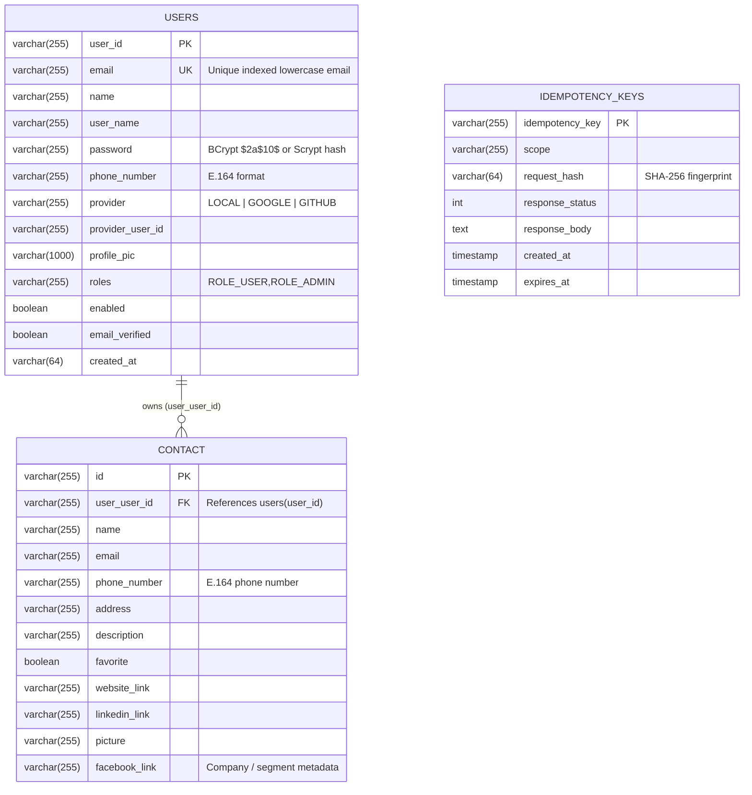

# Polyglot Database Schema & Data Ownership

## 1. Relational SQL Schema (`users`, `contact`, `idempotency_keys`)
Used by **`auth-service`** and **`contact-service`** (deployed on **Aiven Cloud MySQL 8.0** `defaultdb`, local MySQL `scm`, and compatible with PostgreSQL via `database/postgres/001_initial_schema.sql`).

---

## 2. NoSQL Document Store Schema (`MongoDB Atlas 7.0` — `scm_audit_store`)
Used by **`audit-service`** (`cluster0.kr57cwu.mongodb.net/scm_audit_store`).

### Why Document Data Belongs in MongoDB:
- **High-Throughput Append-Only Audit Events (`audit-logs`)**: Security and CRUD events carry heterogeneous metadata (`correlationId`, `actor`, `action`, `resource`, `detail`) that evolve without requiring relational `ALTER TABLE` locks.
- **Flexible Contact Interaction Notes (`contact-notes`)**: Free-form interaction notes attached to contacts (`/v1/contacts/{id}/notes`) are retrieved by `contactId` and indexed by `_createdAt`.
- **Idempotency Replay Store (`idempotency-keys`)**: Stores request SHA-256 fingerprints and serialized HTTP responses with TTL expiration (`expiresAt`).
