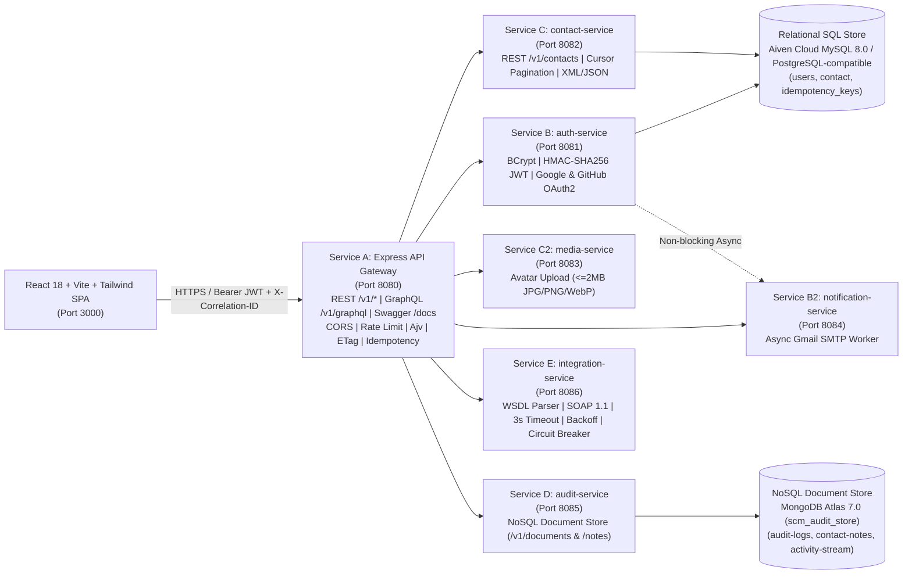

# Target Microservices Architecture (`SCM Enterprise`)

## 1. Architecture Topology

---

## 2. Service Responsibilities & Boundaries

| Service | Port | Primary Technology | Data Ownership | Responsibilities |
| :--- | :--- | :--- | :--- | :--- |
| **Service A: `api-gateway`** | `8080` | Node.js (ESM), Express 4.22, Ajv 8.20 | Edge routing & idempotency metadata | Single public entry point (`/v1/*`, `/v1/graphql`, `/docs`), CORS, token-bucket rate limiting (`429`), Ajv JSON Schema validation (`422`), ETag/304 conditional caching, JSON/XML content negotiation (`406`/`415`), correlation ID propagation, and RFC 7807 error normalization. |
| **Service B: `auth-service`** | `8081` | Java 21, Spring Boot 3.3.4, Spring Security, BCrypt, JJWT | Relational `users` table | User registration (`/v1/auth/users`), credential login (`/v1/auth/tokens`), Google & GitHub OAuth 2.0 flows, stateless HMAC-SHA256 JWT issuance/verification, RBAC (`ROLE_USER`, `ROLE_ADMIN`), and strict sign-up-first enforcement. |
| **Service C: `contact-service`** | `8082` | Java 21, Spring Boot 3.3.4, Spring Data JPA | Relational `contact` table | Contact CRUD (`GET`, `POST`, `PUT`, `PATCH`, `DELETE`, `HEAD`, `OPTIONS`), keyset cursor pagination with RFC 5988 `Link: rel="next"`, contact groups (`/v1/contact-groups`), parameterized SQL queries, and XML/JSON serialization. |
| **Service C2: `media-service`** | `8083` | Java 21, Spring Boot 3.3.4 | `/uploads/contacts` object store | Validates (`<= 2MB`, `image/jpeg`, `image/png`, `image/webp`) and stores contact profile photos (`/v1/media/photos`). |
| **Service B2: `notification-service`** | `8084` | Java 21, Spring Boot 3.3.4, JavaMail / Python SMTP bridge | Notification delivery log | Dispatches transactional welcome and password-reset emails via `smtp.gmail.com:587` with resilient try-catch fallback so mail failures never block core API workflows. |
| **Service D: `audit-service`** | `8085` | Java 21, Spring Boot 3.3.4, Spring Data MongoDB + Node `mongodb` driver | MongoDB Atlas `scm_audit_store` (`audit-logs`, `contact-notes`, `activity-stream`, `idempotency-keys`) | Schemaless NoSQL document persistence for immutable security/audit trails (`/v1/documents/{collection}`) and contact interaction notes (`/v1/contacts/{id}/notes`). |
| **Service E: `integration-service`** | `8086` | Java 21, Spring Boot 3.3.4 | Stateless WSDL/SOAP bridge | Publishes deterministic WSDL (`GET /v1/soap/wsdl`), executes SOAP 1.1 `VerifyPhoneNumber` (`POST /v1/soap/execute` & `/v1/integrations/soap-checks`), enforces a 3-second outbound deadline (`504`), exponential backoff retry (`delay * 2^attempt`), and a 3-state circuit breaker (`CLOSED`, `OPEN`, `HALF_OPEN` at `/v1/resilience/status`). |
